# Credit Card Fraud Prediction and Predictive Analysis

This project applies supervised and unsupervised machine learning techniques to credit card transaction data. It covers fraud classification, transaction amount prediction, clustering, evaluation metrics, and visualization.

## Project Overview

The input dataset contains **284,807 transactions**, **30 input features**, and the target column `Class`.

- `Class = 0`: Genuine transaction
- `Class = 1`: Fraudulent transaction
- Genuine transactions: 284,315
- Fraudulent transactions: 492
- Fraud rate: approximately 0.17%

The dataset is cleaned by removing duplicate rows and missing values. For model training, all 492 fraud transactions and a random sample of 5,000 genuine transactions are used, producing a balanced working sample of 5,492 records.

## Analyses Included

### 1. Fraud Classification

Five classification models are trained using an 80/20 stratified train-test split:

- Logistic Regression
- K-Nearest Neighbors (KNN)
- Gaussian Naive Bayes
- Decision Tree
- Support Vector Machine (SVM)

The features `Time`, `Amount`, and `V1` through `V28` are standardized with `StandardScaler`.

### 2. Transaction Amount Regression

The project predicts `Amount` using:

- Simple Linear Regression
- Polynomial Regression of degree 2
- Multiple Linear Regression

The regression models are evaluated with MAE, MSE, RMSE, and R² score.

### 3. Unsupervised Clustering

The project also performs:

- K-Means clustering with an elbow-method analysis
- K-Means initialization comparison
- Agglomerative hierarchical clustering
- Dendrogram analysis using single, complete, average, and centroid linkage

## Key Results

### Classification Results

The models are sorted by F1 score in `project_outputs/model_comparison.csv`.

| Model | Accuracy | Precision | Recall | F1 Score | ROC AUC | Log Loss |
|---|---:|---:|---:|---:|---:|---:|
| SVM | 0.9817 | 0.9870 | 0.8000 | **0.8837** | 0.9847 | 0.0767 |
| Logistic Regression | 0.9808 | 0.9512 | 0.8211 | 0.8814 | 0.9826 | **0.0671** |
| Decision Tree | 0.9808 | 0.9625 | 0.8105 | 0.8800 | 0.9494 | 0.1718 |
| KNN | 0.9799 | 0.9620 | 0.8000 | 0.8736 | 0.9332 | 0.4474 |
| Naive Bayes | 0.9644 | 0.7800 | 0.8211 | 0.8000 | 0.9713 | 0.8224 |

**Best model by F1 score:** SVM  
**Best model by log loss:** Logistic Regression

### Regression Results

| Model | MAE | MSE | RMSE | R² Score |
|---|---:|---:|---:|---:|
| Simple Linear | 114.0089 | 66145.5142 | 257.1877 | 0.2456 |
| Polynomial (degree 2) | 106.8985 | 58019.3905 | 240.8721 | 0.3383 |
| Multiple Linear | **37.6475** | **8943.6042** | **94.5706** | **0.8980** |

Multiple Linear Regression provides the strongest transaction amount prediction among the tested regression models.

## Repository Structure

```text
.
├── creditcard.csv
├── final.py
├── int234 predictive.py
├── int234Report.docx
├── int234Report.pdf
└── project_outputs/
    ├── 01_class_distribution.png
    ├── 02_model_accuracy.png
    ├── 03_model_f1_score.png
    ├── 04_model_log_loss.png
    ├── 05_roc_curves.png
    ├── 06_confusion_matrix.png
    ├── 07_correlation_with_fraud.png
    ├── 08_amount_distribution.png
    ├── 09_simple_linear_regression.png
    ├── 10_polynomial_regression.png
    ├── 11_multiple_regression.png
    ├── 12_kmeans_elbow.png
    ├── 13_kmeans_clusters.png
    ├── 14_dendrograms.png
    ├── model_comparison.csv
    ├── regression_comparison.csv
    └── test_predictions.csv
```

## Requirements

Python 3.9 or later is recommended. Install the required packages with:

```bash
pip install pandas numpy matplotlib scikit-learn scipy
```

## How to Run

Run the main script from the project directory:

```bash
python final.py
```

The script:

1. Loads and cleans `creditcard.csv`.
2. Samples genuine transactions and combines them with fraud transactions.
3. Trains and evaluates five classification models.
4. Generates classification charts and saves model predictions.
5. Trains and evaluates three regression models.
6. Runs K-Means and hierarchical clustering.
7. Saves all charts and CSV reports in `project_outputs/`.

The script currently contains an absolute path for `creditcard.csv`:

```python
pd.read_csv(r"C:\Users\DELL\Desktop\int234PredictiveProject\creditcard.csv")
```

If the project is moved to another folder or computer, update this path before running the script.

## Generated Outputs

### Classification and Exploratory Analysis

- `01_class_distribution.png` - Genuine and fraud transaction counts
- `02_model_accuracy.png` - Accuracy comparison
- `03_model_f1_score.png` - F1 score comparison
- `04_model_log_loss.png` - Log loss comparison
- `05_roc_curves.png` - ROC curves for all classifiers
- `06_confusion_matrix.png` - Confusion matrix for the best F1 model
- `07_correlation_with_fraud.png` - Twelve features most correlated with fraud
- `08_amount_distribution.png` - Transaction amount distribution by class

### Regression

- `09_simple_linear_regression.png`
- `10_polynomial_regression.png`
- `11_multiple_regression.png`
- `regression_comparison.csv`

### Clustering

- `12_kmeans_elbow.png`
- `13_kmeans_clusters.png`
- `14_dendrograms.png`

### Tabular Reports

- `model_comparison.csv` - Classification metrics for all five models
- `regression_comparison.csv` - Regression metrics for all three models
- `test_predictions.csv` - Test features, actual status, predicted status, and fraud probability from the best model

## Visual Results

### Classification and Exploratory Analysis

#### Class Distribution

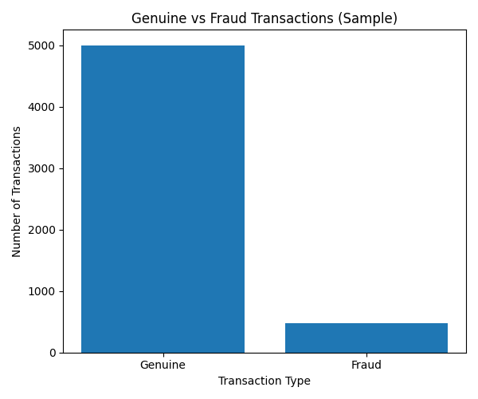

#### Model Accuracy

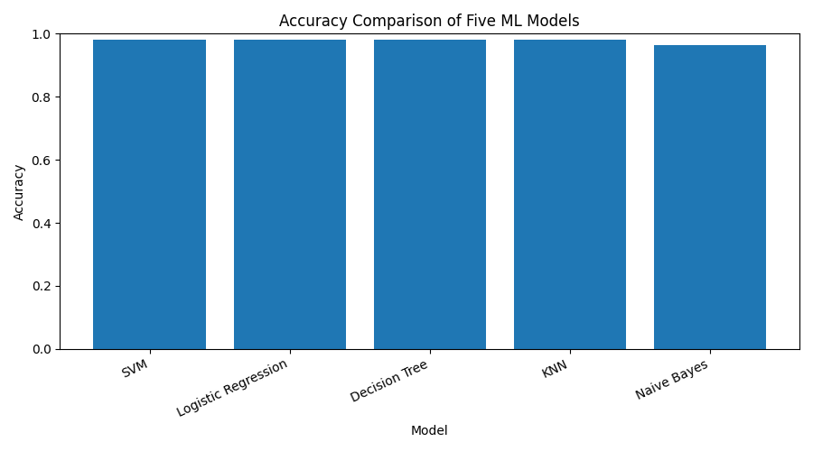

#### Model F1 Score

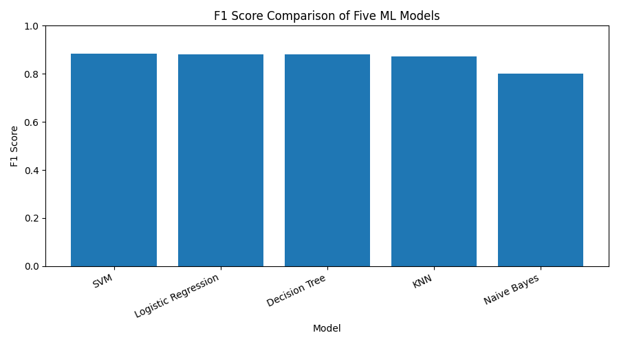

#### Model Log Loss

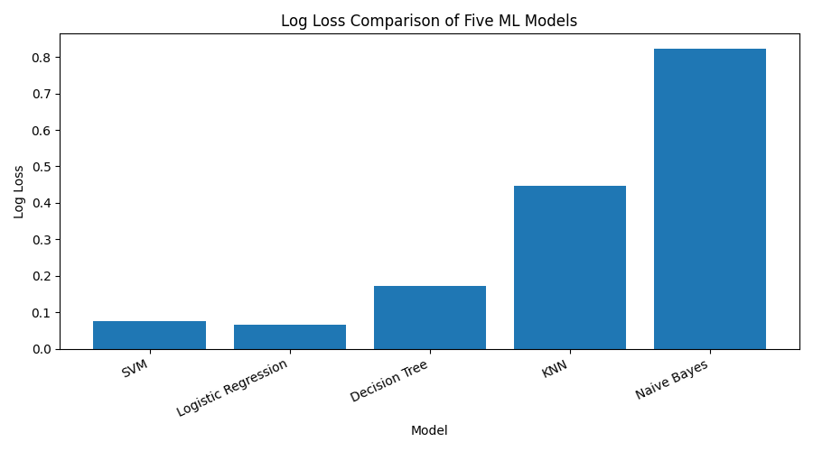

#### ROC Curves

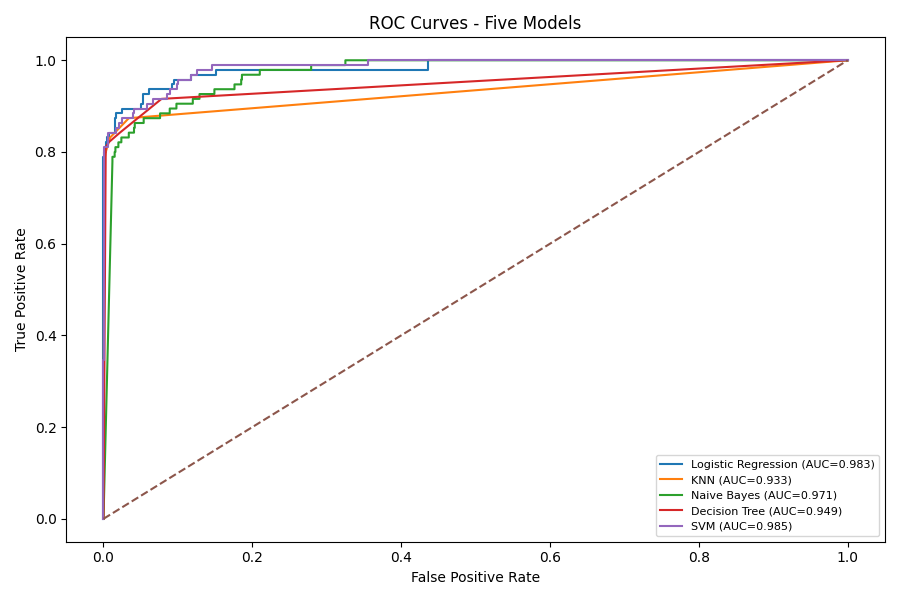

#### Confusion Matrix

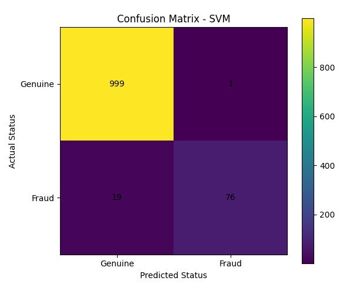

#### Feature Correlation with Fraud

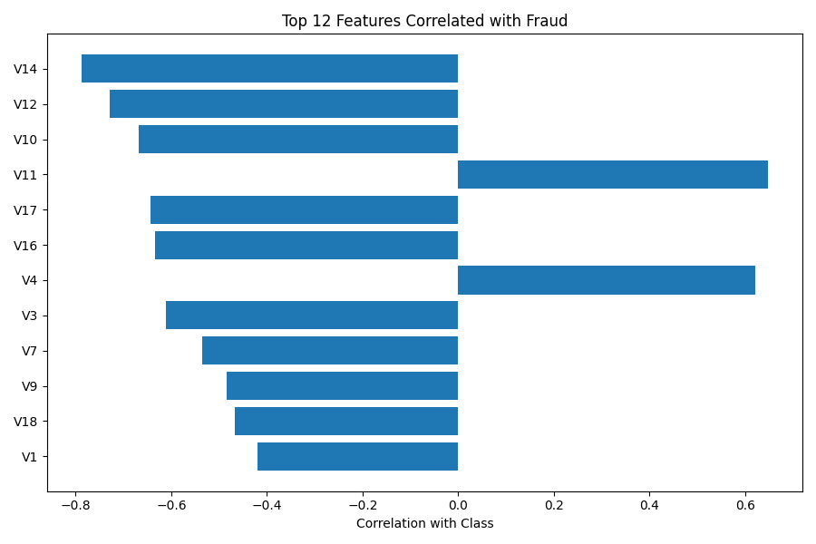

#### Transaction Amount Distribution

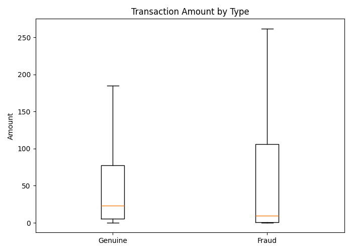

### Regression

#### Simple Linear Regression

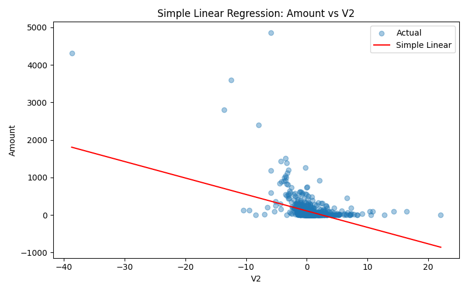

#### Polynomial Regression

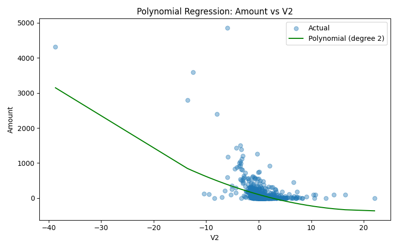

#### Multiple Linear Regression

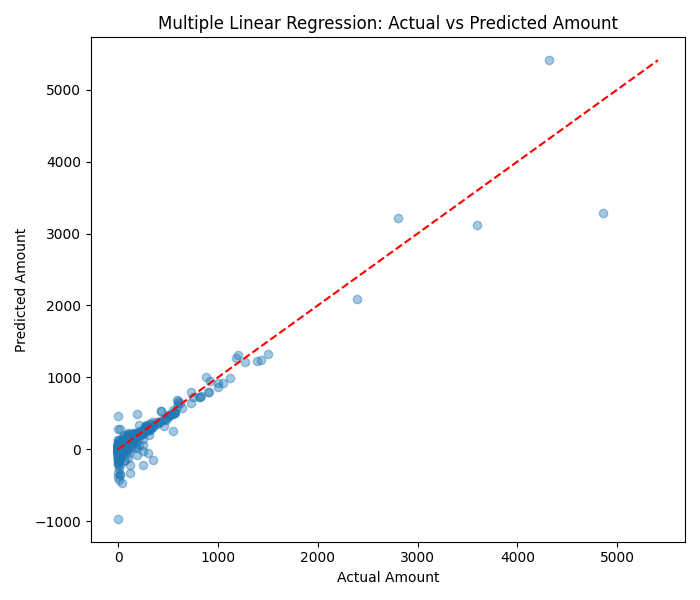

### Clustering

#### K-Means Elbow Method

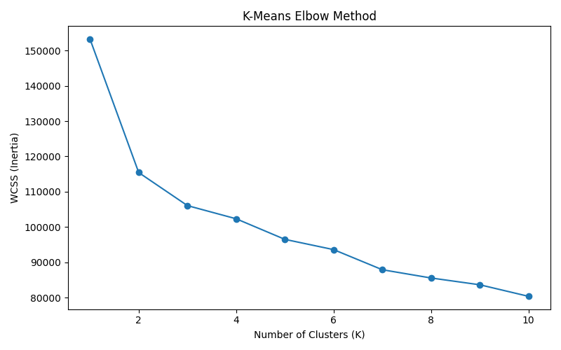

#### K-Means Clusters

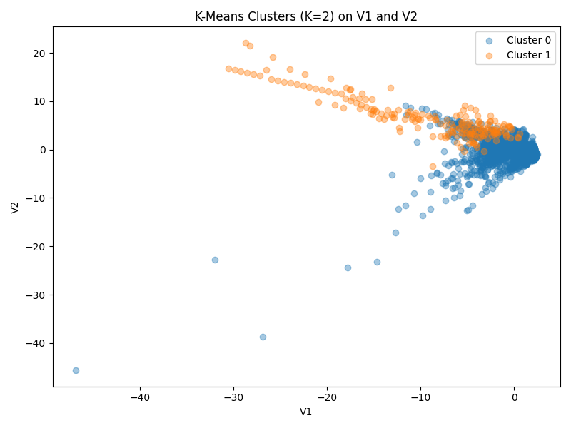

#### Hierarchical Clustering Dendrograms

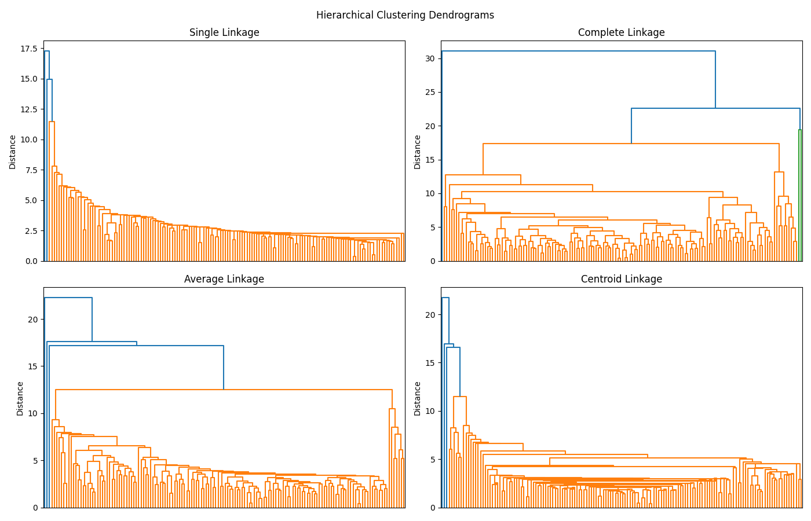

## Reproducibility

The main script uses `random_state=42` for sampling, train-test splitting, model initialization, and clustering wherever applicable. This keeps the generated results consistent across runs when the same environment and input data are used.

## Important Note

The dataset is highly imbalanced. Accuracy alone is therefore not sufficient for judging fraud detection quality. Precision, recall, F1 score, ROC AUC, log loss, and the confusion matrix should be considered together.
